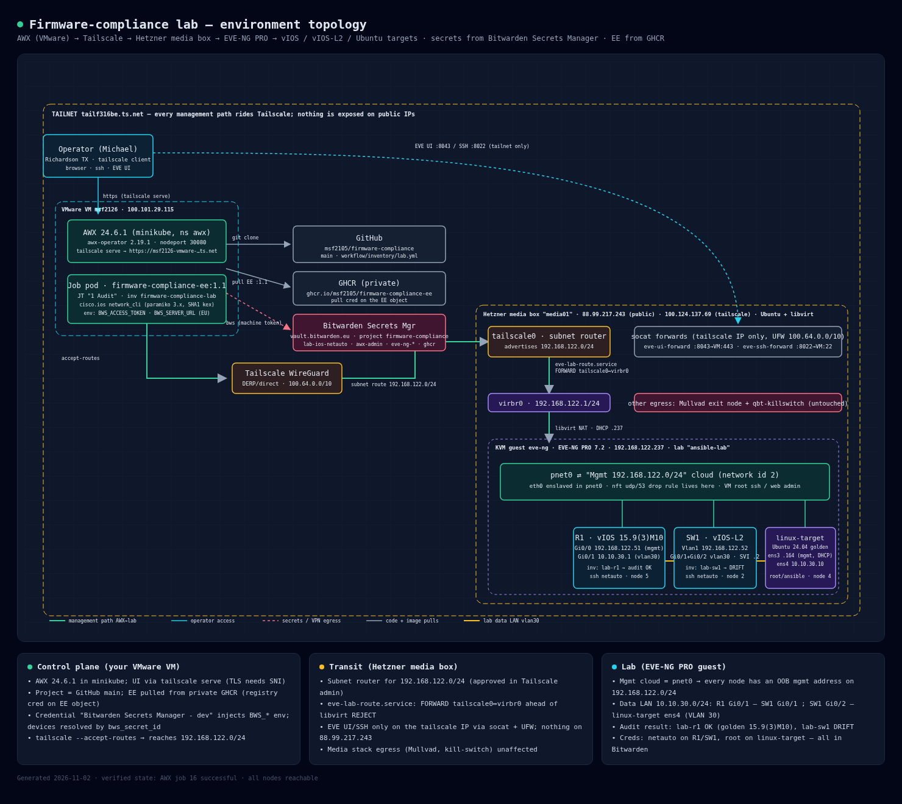

# Lab environment topology



Interactive/dark version: [lab-topology.html](lab-topology.html) (open locally in a browser).

```
Operator (Tailscale client)
  │ https (tailscale serve)                      EVE UI :8043 / SSH :8022 (tailnet only)
  ▼                                                               │
VMware VM 100.101.29.115 ─────────────────────────────────┐       │
  AWX 24.6.1 (minikube)  ──git──▶ GitHub msf2105/firmware-compliance
  Job pod, EE :1.1       ──pull─▶ GHCR  ghcr.io/msf2105/firmware-compliance-ee
                         ──bws──▶ Bitwarden Secrets Manager (EU, project firmware-compliance)
  tailscale --accept-routes                                        │
  │                                                                │
  ▼  Tailscale (WireGuard)  subnet route 192.168.122.0/24          ▼
Hetzner media box "media01" 100.124.137.69 ────────────────────────────────
  tailscale0 (subnet router) ─ eve-lab-route.service ─▶ virbr0 192.168.122.1
                                                         │ libvirt NAT
  KVM guest eve-ng (EVE-NG PRO 7.2, 192.168.122.237) ────┼──────────────────
    pnet0 ⇄ "Mgmt 192.168.122.0/24" cloud                │
      ├─ R1  vIOS 15.9(3)M10   Gi0/0 .51   Gi0/1 10.10.30.1 (vlan30)
      ├─ SW1 vIOS-L2           Vlan1 .52   Gi0/1,Gi0/2 vlan30, Vlan30 10.10.30.2
      └─ linux-target Ubuntu 24.04  ens3 .164 (DHCP)  ens4 10.10.30.10
    Data LAN 10.10.30.0/24:  R1 Gi0/1 ── SW1 Gi0/1 ;  SW1 Gi0/2 ── linux-target ens4
```

| Host | Role | Mgmt IP | Data IP | Audit |
|------|------|---------|---------|-------|
| lab-r1 (R1, node 5) | vIOS router | 192.168.122.51 | 10.10.30.1 | OK — golden 15.9(3)M10 |
| lab-sw1 (SW1, node 2) | vIOS-L2 switch | 192.168.122.52 | 10.10.30.2 (Vlan30) | DRIFT — 15.2 experimental |
| linux-target (node 4) | Ubuntu 24.04 ansible target | 192.168.122.164 | 10.10.30.10 | n/a |

Credentials for every component live in Bitwarden Secrets Manager (project `firmware-compliance`).
